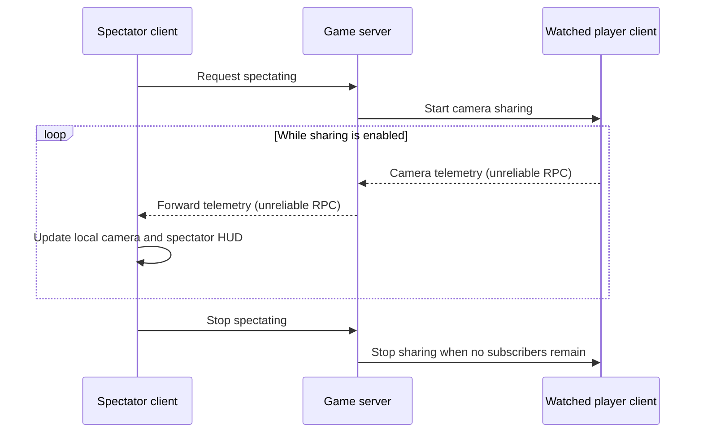

# Inside KittenEye: what Arma Reforger spectators actually see

*A source-based look at camera sharing, administrator tools, and player privacy.*

Does KittenEye let a server administrator see another player's screen? The inspected scripts show something more specific: **the watched player's game sends camera telemetry to the server, which relays it to the spectator. The spectator's game renders the view locally.**

That is not desktop sharing or a video stream. But it is also more than attaching a camera to an ordinary replicated character. KittenEye explicitly requests additional information from the watched client, including its camera transform, field of view, input context, menu cursor position, and recoil state.

## Scope and evidence

This article examines installed copies of three mods by **HideoutKitty**:

| Mod | Inspected package version | Role |
| --- | --- | --- |
| [KittenEye_Tools](https://reforger.armaplatform.com/workshop/66C8A7B6CE49E24D-KittenEye_Tools) | 0.3.9 | Spectating, outlining, statistics, commands, and movement alerts |
| [KittenEye_Core](https://reforger.armaplatform.com/workshop/66CAAA73D189EB5A-KittenEye_Core) | 0.3.0 | Shared helpers and notifications |
| [KittenEye_StealthGM](https://reforger.armaplatform.com/workshop/689B603AD0526DE8-KittenEye_StealthGM) | 1.0.0 | Player-list indicator and ping changes |

The installed `data.pak` archives contained readable Enforce Script files in `FORM`/`PAC1` containers, with zlib-compressed and uncompressed entries. Analysis consisted of extracting those entries locally and tracing the scripts and configuration files.

**This is static analysis, not an in-game test or packet capture.** Statements about calls, fields, and control flow describe the inspected source. Runtime consequences not established directly are marked **[INFERENCE]**. The engine, other mods, server settings, and later releases can change effective behavior.

No extracted mod source or packaged assets are redistributed here. Detailed, unverified security findings are outside this public article's scope. This is an independent analysis, not an official KittenEye publication.

## Following a spectate session

The Game Master context action calls `StartSpectating` on the spectator's component. The server finds the target player's camera-sharing component and instructs the owning client to begin sampling its local camera.

The sending callback uses `POSTFIXEDFRAME`. Most callback executions collect and transmit telemetry; roughly every two seconds, one execution instead refreshes the character, camera, sight, and input-context references, then returns. The code does not establish a universal packets-per-second rate.

The server maintains a list of spectators and forwards each received sample to them. Start and stop instructions use reliable RPCs; the frequent camera updates use unreliable RPCs.

On the receiving client, KittenEye spawns a local `SCR_ManualCamera`. It applies the transmitted transform through `Math.SmoothCD`, with a configured smoothing time of 0.14 seconds, and sets the camera's vertical FOV. Some aiming paths also reposition that camera relative to the weapon sight.

**[INFERENCE]** Network delay, dropped samples, smoothing, local rendering, and sight adjustments mean this is not a pixel-identical or frame-perfect copy of what the player saw.

## What the camera messages contain

The `KE_CameraData` type defines the payload:

| Information | How the watched client obtains it | How it is used |
| --- | --- | --- |
| Camera position and orientation | `GetWorldCameraTransform()` on the current camera | Drives the spectator's local camera |
| Vertical field of view | Camera FOV; while aiming, the smaller of sight FOV and camera FOV | Reproduces the requested zoom |
| Input-context label | Checks a list of active gameplay and UI contexts | Displays a label such as inventory, map, chat, or editor context |
| Cursor-active flag and normalized position | Tests `MenuContext`; reads `WidgetManager.GetMousePos()` and divides by native resolution | Draws a cursor widget on the spectator's HUD |
| Recoil velocity, angular impulse, and availability | Reads the character camera handler's recoil-shake object through added accessors | Displays recoil measurements and a calculated mean |

The cursor is worth emphasizing: **the watched player's in-game cursor coordinates are transmitted**, not merely the spectator's own cursor. The spectator HUD rescales those coordinates to its local resolution.

The context field is less comprehensive than a UI recording. It is one string, refreshed periodically. The loop keeps the last matching active context in its predefined list; it does not transmit every active context, menu contents, chat text, or individual keypresses.

Likewise, recoil values are measurements exposed by the game script, not an automatic finding of cheating. The HUD displays them; the inspected path does not classify a player as using an aimbot or wallhack.

## A reconstructed view, not screen capture

The camera payload contains no image frames. The inspected scripts do not implement desktop capture, video encoding, process enumeration, or collection of the player's external application contents.

That conclusion is limited to these packages. It is not a claim about every mod on a server or about the game's own telemetry.

The spectator also gets presentation changes that can differ substantially from the target's view:

- Local hiding of head models and selected headwear, including prefab-name matching for certain accessories.
- Sight-related camera positioning and visibility changes.
- Automatic enabling of entity outlining when spectating starts, subject to the outlining component's checks.
- An adjustable camera exposure value for brighter or darker viewing.
- A separate HUD containing the target's name, identity UID, FOV, context label, recoil values, and outline radius.

The inspected camera-sharing start path does not display a notification to the watched player. That is a finding about this implementation, not a guarantee that other server components cannot notify them.

## X-Ray: local entity outlines

`KE_XRayViewComponent` queries nearby entities around the spectator camera and outlines living characters in faction colors. It can also outline their vehicles, while excluding the watched character's root hierarchy.

The source defaults are a 200-meter query radius, a two-second query refresh interval, and 100-meter adjustment steps. Outlines are drawn through `World.OutlineEntity` on the observing client.

There is no separate camera-like network message in this component: it works with entities available in the observer's local game world. Its code includes editor/context permission checks; this article does not claim to validate their security enforcement.

## Statistics: useful context, not a verdict

The server-side collector stores statistics in an in-memory map keyed by player identity UID. The inspected collector does not save that map to disk.

It registers `OnProjectileShot` handlers for shot counts, uses `OnPlayerKilled` for kills and deaths, and hooks character damage handling to count hit-zone groups: head, torso sections, arms, and legs.

The statistics menu calculates accuracy as total recorded hits divided by recorded shots, head-hit percentage as head hits divided by total hits, and K/D using deaths as the denominator. Selected zero-denominator cases use a divisor of one.

**[INFERENCE]** These counters should not be interpreted as a clean bullet-accuracy metric. The damage hook does not explicitly restrict counting to bullet damage or hostile human targets. Whether particular explosions, damage-over-time effects, or multi-hit events inflate the result depends on the engine events delivered. Those cases were not tested in-game.

## Movement alerts and external reporting

The optional teleportation-detection system runs on the server. It compares sampled character positions, evaluates movement, and delays reporting to allow authorized editor teleportation to be accounted for. The inspected path logs warnings and can send notifications; it does not implement an automatic ban or kick.

Its configuration is stored at `$profile:KittenEye_WebhookConfig.json`:

| Setting | Purpose in the inspected source |
| --- | --- |
| `admin_in_game_notification` | Enables the notification option and participates in activating detection |
| `webhook_url` | Supplies the destination for server-side HTTP reporting; a nonempty value also activates detection |
| `server_display_name` | Labels the server in report messages |
| `disable_vehicle_detection` | Disables the vehicle movement-check branch |
| `tp_detection_debug_log` | Adds diagnostic position details to the warning text |

The webhook sends JSON containing `username` and `content`. Warning text can contain the player's name, identity UID, movement measurements, and, with diagnostic logging enabled, positions. The URL comes from server configuration rather than a hard-coded author endpoint.

This was the explicit external HTTP reporting path identified in the inspected scripts. In-game RPC traffic is separate. UI code also accesses the Workshop API to scan offline items and display the installed mod version.

A server operator should treat exported identifiers and movement reports as player data, and verify actual notification behavior in their own environment before relying on it.

## Commands and the companion mods

The chat commands declare the administrator role requirement:

- `#find <name>` or `#find uid <UID>` locates a player and uses the caller's Game Master camera to follow them.
- `#setrank <RANK> <target>` adjusts XP toward a rank. Its all-player path avoids demoting players already at or above that rank.
- `#autorank <RANK>` sets a rank target for subsequent successful player-audit events. Eligible players receive XP once per UID in the component's in-memory recipient list; `#autorank stop` disables it.

`setrank` and `autorank` also implement RCON execution with an admin permission declaration. The inspected `find` class does not define an equivalent RCON execution override.

**KittenEye_Core** provides identity, faction, vehicle, and notification helpers, plus a script call queue ticked from the game update callback. It is supporting code rather than a separate spectator interface.

**KittenEye_StealthGM** overrides the player-list Game Master indicator to hide it. Its `SendPing` override emits the local "no GM to ping" notification and returns without calling the original implementation. This establishes what happens for calls through that override, not that every possible ping system in the game is disabled.

## Default controls in the inspected package

These are packaged bindings, not a guarantee about a player's customized settings or platform-specific button labels.

| Action | Keyboard / mouse | Gamepad input |
| --- | --- | --- |
| Toggle outlines | X | Y |
| Stop spectating | Escape | B |
| Increase / decrease outline radius | Page Up / Page Down | D-pad up / down |
| Open statistics | H | A |
| Increase / decrease exposure | Mouse wheel | D-pad right / left |
| Reapply headwear hiding | U | X |

Outline toggling is registered in both the editor and spectator contexts. The other listed controls are registered in the spectator context.

## Source map

Paths below identify files inside the locally inspected packages. They are references for reproducing the analysis against an authorized local copy, not links to redistributed source. Tools paths are relative to `scripts/Game/` unless stated otherwise.

| Topic | Primary files |
| --- | --- |
| Camera collection and payload | `Components/KE_CameraDataSharingComponent.c`; `Codec/KE_CameraData.c` |
| Spectator rendering and lifecycle | `Components/KE_SpectateUserCompent.c` (filename spelling as shipped) |
| Cursor and recoil display | `UI/KE_SpectateInfoDisplay.c` |
| Outlining | `Components/KE_XRayViewComponent.c` |
| Statistics collection | `Components/GameMode/KE_PlayerStatisticCollectorComponent.c`; `Components/Damage/KE_SCR_CharacterDamageManagerComponent.c` |
| Statistics display | `UI/Menu/PlayerStatisticsMenu/KE_PlayerStatisticsMenu.c` |
| Movement checks and reporting | `Systems/KE_TeleportationDetectionSystem.c`; `GameMode/KE_SCR_BaseGameMode.c`; `Json/KE_KittenEyeConfigJson.c` |
| Commands | `Network/ServerCommands/KE_FindPlayerCommand.c`; `KE_SetRankCommand.c`; `KE_SetAutoRankCommand.c` |
| Controls | Tools package: `Configs/System/chimeraInputCommon.conf` |
| StealthGM changes | StealthGM package: `scripts/Game/Editor/Components/Editor/KE_SCR_PingEditorComponent.c`; `scripts/Game/UI/HUD/KE_SCR_PlayerListMenu.c` |

## The practical distinction

KittenEye's inspected spectator implementation is **a live, client-supplied camera telemetry stream combined with local rendering**. It exposes more than ordinary character movement, but it does not implement screen sharing.

For players, the important questions are which telemetry is collected, when it is requested, who can access it, and where alerts are exported. For administrators, a reconstructed view and derived statistics are investigative aids—not, by themselves, proof of cheating.
